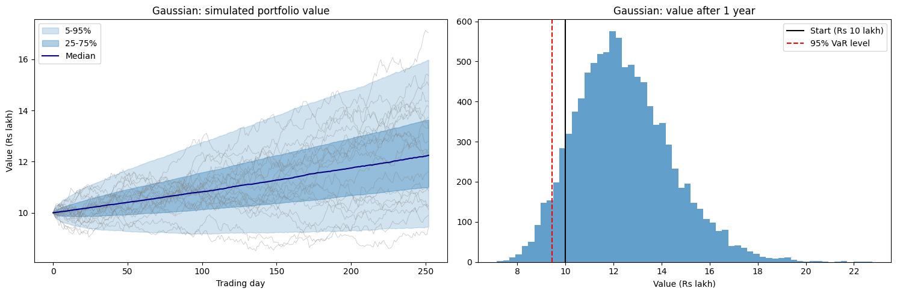
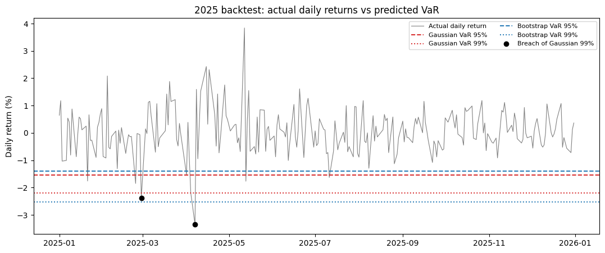

# Monte Carlo Portfolio Risk Simulation (Indian Equities)

**How risky is a ₹10 lakh portfolio of 5 large-cap Indian stocks, and can a simple model be trusted to measure it?**
I built two Monte Carlo risk models on cleaned NSE data and tested them on data they had never seen.

**Stocks:** RELIANCE · TCS · ICICIBANK · BHARTIARTL · LT  |  **Data:** NSE daily prices, 2021-2025  |  **Stack:** Python, pandas, NumPy, SciPy, matplotlib

---

## Key results (30-second read)

| # | Finding |
|---|---|
| 1 | **Fixed hidden data errors.** Raw NSE prices showed a fake **-49.8%** one-day "crash" (Reliance's 1:1 bonus). I adjusted for 3 corporate actions from the official NSE list and checked the result against Yahoo Finance (daily-return correlation **0.995 or higher** for all 5 stocks). |
| 2 | **Real returns have fat tails.** The portfolio had **17 days** beyond 3 standard deviations, where a normal curve predicts about **3**. |
| 3 | **The Gaussian model underestimates extreme-day risk.** 1-day 99% CVaR: **2.47%** (Gaussian) vs **3.63%** (bootstrap), about 47% higher. |
| 4 | **Backtested on unseen 2025 data.** No model failed the Kupiec test, but the Gaussian model **understated how bad its worst days were** (average loss 3.34% vs 2.52% predicted on a second test split that includes the June 2024 election crash). |

---

## What I built

```
Clean NSE data → Fix corporate actions → Validate vs Yahoo → Find fat tails
        → Train/test split (2021-24 / 2025) → Two Monte Carlo models → VaR & CVaR → Backtest on 2025
```

**Two models**

| | Gaussian model | Bootstrap model |
|---|---|---|
| **Idea** | Assume daily returns follow a bell curve, then generate random futures from it | Re-draw real historical days at random to build new futures |
| **Strength** | Clean, fast, standard | Keeps real correlations and real crash days |
| **Weakness** | Treats extreme days as very rare | Can never produce a day worse than its history |

A third version, the **block bootstrap**, draws chunks of 10 consecutive days to keep calm and stormy periods together.

**Setup:** ₹10 lakh split equally across the 5 stocks, 10,000 simulated futures of 252 trading days (one year) each.

---

## Results

*VaR 99% = the loss that should not be exceeded on 99% of occasions. CVaR = the average loss in the worst cases beyond that.*

**Simulated risk (trained on 2021-2024)**

| Metric | Gaussian | Bootstrap | Block bootstrap (10d) |
|---|---|---|---|
| 1-year VaR 95% | 5.4% | 5.2% | 4.5% |
| 1-year CVaR 95% | 10.9% | 11.4% | 10.3% |
| 1-day VaR 99% | 2.17% | 2.48% | 2.53% |
| 1-day CVaR 99% | **2.47%** | **3.63%** | 3.55% |

**Backtest at the 99% level (how many bad days, and how bad)**

| Test period | Model | Breaches (expected) | Kupiec test | Avg loss on breach vs model's CVaR |
|---|---|---|---|---|
| 2025 (249 days) | Gaussian | 2 (2.5) | Pass | 2.87% vs 2.53% |
| 2025 (249 days) | Bootstrap | 1 (2.5) | Pass | 3.34% vs 3.59% |
| 2024-25 (498 days) | Gaussian | 6 (5.0) | Pass | **3.34% vs 2.52%** |
| 2024-25 (498 days) | Bootstrap | 3 (5.0) | Pass | 4.32% vs 3.30% |

**Reading it:** both models got the *number* of bad days about right, but the Gaussian model consistently understated the *size* of the worst ones. The bootstrap was closer, though it also fell short on the 6.8% crash of 4-Jun-2024, because that day was worse than anything in its training data.

### Figures





---

## Honest limitations

- **Price returns only.** Dividends are not included.
- **Short, bullish training window** (4 years, about 24% average yearly return). The mean return is not a forecast, and the risk numbers are the focus.
- **Small test sample.** 249 days and only 1-2 breaches at 99%, so the backtest cannot rank the models with certainty. The claim is "no model rejected, Gaussian understates tail severity", not "bootstrap is proven better".
- **Simple portfolio.** Equal weights, buy-and-hold, no costs, static (not rolling) risk estimates.

---

## Skills demonstrated

Monte Carlo simulation · Value at Risk and Expected Shortfall · Bootstrap and block bootstrap · Cholesky decomposition for correlated returns · Out-of-sample backtesting (Kupiec test) · Statistical testing (Jarque-Bera, variance ratio) · Financial data cleaning and corporate-action adjustment · Cross-source data validation · Python (pandas, NumPy, SciPy, matplotlib)

---

## Project structure

```
monte-carlo-portfolio-risk/
├── README.md                                # you are here
├── requirements.txt
├── notebooks/
│   └── monte_carlo_portfolio_risk.ipynb     # full analysis, run top to bottom
├── data/
│   ├── raw/                                 # NSE price CSVs
│   ├── corporate_actions/                   # NSE corporate actions CSVs
│   └── processed/                           # adjusted_prices.csv, log_returns.csv
├── images/                                  # charts shown above
└── docs/
    └── METHODOLOGY.md                       # detailed methods, all tables, glossary
```

## How to run

```bash
pip install -r requirements.txt
jupyter notebook notebooks/monte_carlo_portfolio_risk.ipynb     # then Run All
```

Fixed settings: 10,000 simulations, 252 days, ₹10,00,000, equal weights, random seed 42.

**Want the details?** See [`docs/METHODOLOGY.md`](docs/METHODOLOGY.md) for the full data-cleaning workflow, corporate-action table, Yahoo validation, every result table and a plain-English glossary.

*Educational project. Not investment advice.*
